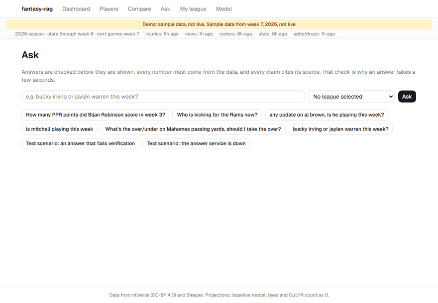

# fantasy-rag

A fantasy football (NFL) assistant that answers questions by routing them to typed tools
over real stats, your Sleeper leagues' own scoring, projections and news, citing a source
for every claim. Numbers are checked in plain Python before an answer is shown; a draft
that fails the check is never displayed.



*Recorded in demo mode (labelled sample data, no account or API key needed).*

## What it does

- **Ask:** chat with streamed progress, then one validated answer with numbered sources (player pages, projections, news links).
- **Players and compare:** weekly stats and fantasy points under PPR, half or standard scoring, plus next week's projections with an 80% range.
- **My league** (Sleeper, read-only):
  - your roster scored with your league's rules;
  - a lineup optimizer;
  - start/sit;
  - waivers with transaction-aware availability.
- **Model:**
  - a frozen benchmark of the baseline against Ridge and LightGBM;
  - range coverage;
  - a FantasyPros comparison;
  - forward results on unseen 2026 weeks.
- **Health:** the header warns when a data source is stale or failing.

Architecture and data flow: [docs/architecture.md](docs/architecture.md). Full plan and
status: [docs/PLAN.md](docs/PLAN.md).

## Results (from saved evaluation runs)

| What | Result | Notes |
|---|---|---|
| News retrieval, recall@5 (20 labelled questions) | **1.0** (hybrid), MRR 0.91 | Keyword beats vector on bare-name lookups (MRR 0.933 vs 0.676) |
| Tool routing accuracy (60 questions + 4 no-support) | **93.3%** original rubric, 96.7% revised | Prompt-injection fixture passed; manual review: 60/64 answers fully supported |
| Answers withheld by the number/citation checks | 0 of 64 | One repair attempt, then withheld |
| Projections, frozen 2025 benchmark (PPR) | Ridge beats the baseline for **TE only**: MAE −2.4% (95% CI −0.16 to −0.02 pts) | QB/RB/WR stay on the baseline; LightGBM wins nowhere |
| 80% range coverage, 2025 | 77–82% for every position and format | Nominal 80%, measured, not promised |
| FantasyPros (Friday rankings) vs our Tuesday projections | Spearman 0.643 vs 0.586; start/sit 68.0% vs 65.3% | FantasyPros had three more days of news |

Projection results assume each week's stats were published by Tuesday noon. That can't be
verified for past seasons, which is why the forward log on unseen 2026 weeks exists.

## Run it

**Demo mode** (no database, no keys):

```bash
docker compose --profile demo up api-demo
```

```bash
cd frontend && npm install && npm run dev -- --port 3010
```

Open http://127.0.0.1:3010.

**Full local setup:**
1. Copy `.env.example` to `.env` and set `SLEEPER_USERNAME`. `ANTHROPIC_API_KEY` is needed only for chat.
2. Run the commands below.

```bash
docker compose up -d db
```

```bash
cd backend && uv sync && uv run alembic upgrade head
```

```bash
cd backend && uv run fantasy-rag ingest structured && uv run fantasy-rag league import && uv run fantasy-rag ingest news
```

```bash
cd backend && uv run uvicorn fantasy_rag.api.main:app --port 8010
```

```bash
cd frontend && npm run dev -- --port 3010
```

Everything binds to 127.0.0.1. Nothing is exposed to your network.

**Scheduled collection** (Windows Task Scheduler, current user):
- the daily ingest plus Wednesday–Saturday injury snapshots;
- hourly news and transactions;
- the Tuesday forward prediction and its pre-deadline check;
- a daily backup with a Sunday restore drill.

Failures show a Windows toast.

```bash
powershell -File scripts/register_daily_ingest.ps1
```

**Backups** go to `%USERPROFILE%\fantasy-rag-backups` (outside the repo; they contain league
data):

```bash
cd backend && uv run fantasy-rag backup
```

```bash
cd backend && uv run fantasy-rag backup --verify-latest
```

Restoring after losing the container: start a fresh `pgvector/pgvector:0.8.7-pg16`
container. Load the dump's `.roles.sql` with `psql`, then the `.dump` with `pg_restore`.
`--verify-latest` performs and checks exactly these steps.

## Data and terms

- Stats: [nflverse](https://github.com/nflverse) (CC-BY 4.0).
- League, status and trending data: the [Sleeper API](https://docs.sleeper.com/), read-only and non-commercial.
- News: stored as title, summary and link only.
- Rankings comparison: FantasyPros via `nflreadpy`.

This is a personal, non-commercial project.

## Limitations

- **Local only:** collection needs this PC on with Docker running, especially at Tuesday 07:30 Pacific. A missed week is shown as missing, never filled in. Hosted deployment is planned, not done.
- **No injury or betting-line inputs** in the projections yet. Our own injury snapshots start Oct 20, 2026.
- **Backups stay on this disk** unless you point `BACKUP_DIR` at other storage.
